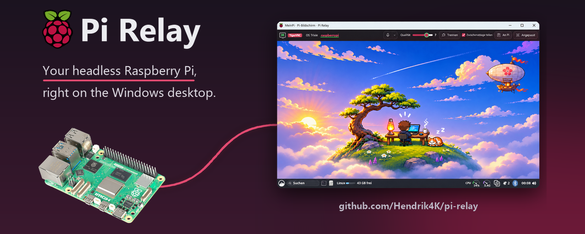

# Pi Relay <a href="README.en.md"></a><a href="README.md"></a>

<p align="center"></p>

**Built for headless access to your Raspberry Pi: control it from your Windows desktop in a small viewer window, with no open VNC ports and updates built in.**

<p align="center"> <a href="https://github.com/Hendrik4K/pi-relay/releases/latest"></a>  <a href="https://github.com/Hendrik4K/pi-relay/actions/workflows/ci.yml"></a></p>

The manual fits on a beer mat: download, point it at your SSH key (a YubiKey is welcome, the Pi loves hardware), confirm once. From then on Pi Relay knocks through an SSH tunnel whenever needed and you work on the Pi as if it sat next to you. With a built-in FPS counter, in case you want to watch your Pi sweat.

<p align="center"></p>

<p align="center"></p>

<details>
<summary><b>🚀 Quickstart</b></summary>

1. Download the installer under **Releases** (on the right) and run it. It installs for you only, no admin rights. If Windows SmartScreen says "Windows protected your PC": **More info → Run anyway** (the installer isn't code-signed).
2. Add your Pi to the SSH configuration as shown under **Requirements**.
3. Click the raspberry in the bottom-right taskbar, click your access and confirm your security key.
4. Screen icon for the Pi desktop, `>_` for the terminal. Done.

**Laid-back type?** Then just hand this prompt to your AI agent (e.g. Claude Code or Codex on your PC). It finds out what's already installed, what's missing and what your Pi is called on the network, and asks you before every change.

```text
Help me set up Pi Relay (github.com/Hendrik4K/pi-relay) on this Windows PC so I can use my Raspberry Pi without a monitor.
Check first and ask me before every change:
1. Windows 10/11 64-bit, OpenSSH client (`ssh -V`) and WebView2 present? If something is missing, tell me how to install it.
2. Download the latest installer from the GitHub releases, compare its SHA256 with the .sha256 file and run it only after my OK.
3. Find my Pi on the network (e.g. `raspberrypi.local` or via the ARP table) or ask me for its IP address and user name.
4. Check `~/.ssh/config` for an entry for the Pi. If there is none, propose one (`Host MeinPi`, `HostName`, `User`) and add it after my OK.
5. Check whether I have an SSH key. Never read private keys. Don't create a new key or copy one to the Pi without asking me first (for a YubiKey: `ssh-keygen -t ed25519-sk`).
6. Check over SSH that the Pi has Python 3 and a VNC server listening on `127.0.0.1:5900` only. If it's missing, propose TigerVNC (`tigervnc-scraping-server`) with `-localhost` and run `sudo` commands only after my OK; I type the password myself.
7. Finally tell me how to open Pi Relay from the raspberry in the taskbar and connect.
```

**Build it yourself (for tinkerers):** you need the .NET 10 SDK, Node.js 22 or newer and, for the installer, Inno Setup 6. Then, in the project folder:

```bash
npm ci
powershell -ExecutionPolicy Bypass -File build-windows.ps1
powershell -ExecutionPolicy Bypass -File scripts/run-checks.ps1
powershell -ExecutionPolicy Bypass -File build-installer.ps1
```

</details>

<details>
<summary><b>💡 What it does</b></summary>

Pi Relay is a no-fuss bridge to your Raspberry Pi without a monitor. No more HDMI cables.

- **Your own remote screen for the Pi, right in Windows.** A dedicated window where you see and use the Pi like a second screen. Everything runs through your SSH connection.
- **Mouse, keyboard and microphone.** Use your Windows PC's mouse, keyboard and microphone without plugging anything into the Pi.
- **Files and clipboard.** Drag & drop files into the window and they land on the Pi desktop. Copy & paste works both ways: whatever you copied last, you keep using right on the Pi. And "To Pi" sends it over again any time.
- **Terminal with one click.** The `>_` button next to your access opens a real SSH terminal on your Pi.
- **Your AI agents right on the Pi.** Codex (ChatGPT) or Claude work in one project folder you share. Reading is fine; changing files and running commands you switch on one by one.
- **Keys under control.** Manage your SSH keys right in the app; YubiKey & co. work.
- **Your own pictures.** Stay on the Pi, Codex or Claude with the mouse for about 5 seconds, then click "Change PNG" and pick your picture.
- **English or German.** One click on the language switch in the settings and everything changes language.
- **Low-key and plug & play.** Pi Relay waits quietly in the taskbar and is there with one click.

<ins>Why this exists:</ins> I had exactly this problem and found no ready-made solution. So I built one and now share it with everyone.

</details>

<details>
<summary><b>🔎 Extra pictures of the panel</b></summary>

<p align="center"> </p>

</details>

<details>
<summary><b>🧰 Requirements</b></summary>

Pi Relay runs with the following software. Here's what you need where. Everything required ships by default, but you can also use a different VNC server or viewer.

**On Windows:** Windows 10 or 11 (64-bit). WebView2 and the SSH client already come with current Windows versions. Pi Relay brings its own viewer (noVNC).

**On the Pi:** SSH and Python 3 (both ship with Raspberry Pi OS).

**The connection to the Pi** is set up once in your SSH configuration (`~/.ssh/config` on Windows), for example:

```
Host MeinPi
  HostName 192.168.1.50
  User pi
```

Pi Relay shows every such entry as an access. It only reads your public keys; it never touches private keys and never creates new ones.

**For the Pi screen** the Pi needs a program that shares its desktop (a VNC server). Important: it may listen **on the Pi itself only** (`127.0.0.1:5900`), not on your whole network. Pi Relay then fetches the picture safely through the SSH line. Three proven options:

**TigerVNC** (our pick, around 45 instead of 5 frames per second on a Pi 5 compared to x11vnc). Package `tigervnc-scraping-server`, in your user's autostart:

```bash
X0tigervnc -display :0 -rfbport 5900 -localhost -SecurityTypes None -AlwaysShared -AcceptSetDesktopSize=0
```

**x11vnc** (X11 desktop, e.g. Cinnamon), also in the autostart:

```bash
x11vnc -localhost -rfbport 5900 -forever -shared -nopw -quiet -noxdamage
```

**WayVNC** (Wayland, e.g. labwc), in `/etc/wayvnc/config`:

```ini
use_relative_paths=true
address=127.0.0.1
enable_auth=false
```

**In short:** `-localhost` or `address=127.0.0.1` means "reachable on the Pi itself only". That's a must here, because no VNC password is set. In the screen window, quality 7 is the sweet spot (the green dot on the slider).

<details>
<summary>🆘 <b>Emergency tips:</b> password, firewall rule and what happens after a Pi restart</summary>

Nobody on the network can reach the VNC server, only Windows through your SSH connection. Programs or other users **on the Pi itself** could, though. If you're the only one using the Pi, that's fine. Otherwise set a VNC password (WayVNC `enable_auth=true`, x11vnc `-rfbauth`): Pi Relay asks for it in the window and keeps it only while the app runs. Also, Pi Relay only connects when port 5900 belongs to your own user or root, so a foreign program jumping the queue gets neither keyboard nor clipboard.

Instead of a password you can use a firewall rule (nftables) that opens the port for your desktop user only. Replace `1000` with that user's number (UID), load it with `sudo nft -f vnc-schutz.nft`, permanently via `/etc/nftables.conf`:

```
table inet vnc_schutz {
  chain ausgang {
    type filter hook output priority 0; policy accept;
    oifname "lo" tcp dport 5900 meta skuid != { 1000, 0 } reject with tcp reset
  }
}
```

If the Pi is restarting, Pi Relay waits patiently: click "Verbinden" and it connects exactly once as soon as the Pi answers again (up to 3 minutes). If the VNC server needs a little longer after boot, the viewer keeps trying for up to 2 minutes. It never asks for your security key on its own.

A second access named `Ersatzzugang` (e.g. with a spare key) is shown as a collapsible backup below the first one.

</details>

</details>

<details>
<summary><b>🔒 Tech and security</b></summary>

**How it works**

- **Screen:** VNC with noVNC built in, because it's solid and proven. The picture comes through your SSH connection; no VNC port is open on your network. For new noVNC versions Pi Relay builds a tested update at the push of a button, so you never get stuck with old security holes.
- **Mouse and keyboard** go to the Pi over VNC, as if you were sitting in front of it.
- **Microphone:** VNC carries no audio. The "Mic" switch in the screen window (off by default) sends your Windows microphone (48 kHz, mono) through the SSH connection to the small receiver [`pi/windows-mikro-empfang`](pi/windows-mikro-empfang). It plays it into a virtual microphone "Windows-Mikrofon (Pi Relay)" on the Pi ([`pi/windows-mikrofon.conf`](pi/windows-mikrofon.conf), PipeWire) and makes it the default microphone. Set it up once on the Pi, then `--status` says "bereit (ready)":

  ```bash
  mkdir -p ~/.local/bin ~/.config/pipewire/pipewire.conf.d
  curl -fsSL https://raw.githubusercontent.com/Hendrik4K/pi-relay/main/pi/windows-mikro-empfang -o ~/.local/bin/windows-mikro-empfang
  curl -fsSL https://raw.githubusercontent.com/Hendrik4K/pi-relay/main/pi/windows-mikrofon.conf -o ~/.config/pipewire/pipewire.conf.d/windows-mikrofon.conf
  chmod +x ~/.local/bin/windows-mikro-empfang
  systemctl --user restart pipewire
  ~/.local/bin/windows-mikro-empfang --status
  ```
- **Files:** Files you drag & drop land only on the Pi desktop (`~/Desktop`), up to 512 MiB per file. Their path is in the Pi clipboard afterwards.
- **Clipboard:** When you switch to the screen window, the Windows text you copied last goes to the Pi; whatever you copy on the Pi lands in Windows. "To Pi" sends the Windows clipboard by hand any time.

**Security**

- No network service on the Pi: the worker (`native/remote_worker.py`) only runs for the duration of the SSH session.
- The VNC tunnel knows exactly one fixed target (`127.0.0.1:5900`), never a freely chosen address.
- Agent file access is limited to the granted folder; `/` is refused as a project folder, the home folder (and any folder above it) is read-only, and even then its hidden folders stay closed. Hidden folders such as `~/.config` (autostart!) are writable only together with commands. Without the command permission, hidden files and folders (e.g. `.git/`, `.bashrc`) as well as executable and multiply linked files are refused. Keys, credentials and histories (`~/.ssh`, `~/.gnupg`, `~/.codex`, `~/.claude`, `.git-credentials`, shell histories, browser profiles) are never readable by agents. Write access is still powerful, e.g. for build scripts in the folder. Granted **shell commands** run with the Linux user's rights; for real separation use a dedicated restricted Pi user.
- The MCP server is a local named pipe for the current Windows user only; a pipe of the same name owned by another account is refused.
- The local port for an external viewer (RealVNC/TigerVNC) serves only the viewer Pi Relay started itself, and only under your own Windows account.
- Pi Relay's SSH connection takes no forwardings from the ssh config (agent, X11, ports, LocalCommand).
- "Zwischenablage teilen" (clipboard sharing) works in both directions only while the screen window is in front; a reconnect in the background transfers nothing. Windows text goes to the Pi when you switch into the window (up to 1 MiB), except content that password managers mark as confidential (that only goes via "An Pi"). Text from the Pi arrives without control and direction characters and without a trailing line break, so nothing runs by itself when pasted into a console. Both directions can be switched off in the settings.
- Restarting or activating while SSH connections are open asks first.
- The interface runs under a strict Content Security Policy; downloads and permissions (except the microphone in the screen window) are blocked. The installer installs inside the user profile only.
- Pi Relay takes noVNC updates no earlier than 14 days after release, without install scripts and with npm signature verification.
- Oversized or unexpected answers from the Pi only end that single request, not the connection or the app.

</details>

<details>
<summary><b>🖼️ Pictures and trademarks</b></summary>

The two companions for Codex and Claude in this edition are look-alikes drawn for it. If you prefer other pictures, swap them for your own in the app via "Change PNG" ("PNG ändern" in German).

The source code is under the [MIT license](LICENSE). The characters, the case picture and the icons are **not** covered by it. Raspberry Pi, Claude/Anthropic, Codex/OpenAI, RealVNC and other names are trademarks of their owners. Pi Relay is a private hobby project and not affiliated with any of these companies. Details and third-party software (noVNC, MPL-2.0): see [THIRD-PARTY-NOTICES.md](THIRD-PARTY-NOTICES.md).

</details>
