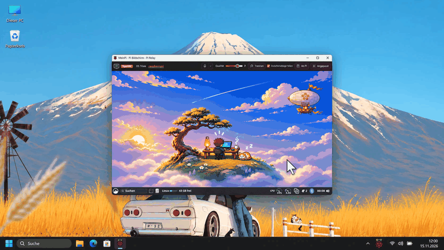

# Pi Relay &nbsp;<a href="README.md"></a> <a href="README.en.md"></a>

**Built for headless access to your Raspberry Pi: control it from your Windows desktop in a small viewer window, with no open VNC ports and updates built in.**

The manual fits on a beer mat: download, point it at your SSH key (a YubiKey is welcome, the Pi loves hardware), confirm once. From then on Pi Relay knocks through an SSH tunnel whenever needed and you work on the Pi as if it sat next to you. With a built-in FPS counter, in case you want to watch your Pi sweat.

<p align="center"></p>

<p align="center"></p>

<p align="center"></p>

<p align="center"></p>

*The app's interface is in German.*

<details>
<summary><h2>What it does</h2></summary>

- **One SSH channel per access.** Terminal, screen and agents share the same OpenSSH connection. Hardware security keys (FIDO2/`sk-`) work; you confirm once.
- **Integrated Pi screen.** noVNC runs locally in its own window and tunnels RFB through the existing SSH connection to `127.0.0.1:5900` on the Pi. No open VNC port, no local listener, no account and no external viewer. The window smoothly snaps to the desktop's aspect ratio, files can be dragged straight onto the Pi desktop, and the clipboard is shared. RealVNC/TigerVNC remain available as an explicitly chosen fallback.
- **A real terminal** (xterm.js with a Linux PTY) in its own window.
- **Codex and Claude as agents on the Pi.** Pi Relay provides a local MCP server (`PiRelay.exe --mcp codex|claude`). You choose a project folder per agent; writing and commands are off by default and are granted individually. The status shows "SSH ready", "Connected" and "Working".
- **Windows microphone on the Pi:** the "Mikro" switch in the screen window sends your Windows microphone (48 kHz, mono) over the same SSH connection to a receiver program on the Pi (`~/.local/bin/windows-mikro-empfang`, e.g. a PipeWire source). VNC itself carries no audio.
- **Little extras:** ping reachability (ICMP only, no login), change the Pi's address in place (updates `~/.ssh/config` and `known_hosts` with a backup), board facts (model, RAM, storage), your own pictures via "PNG ändern" (rest the mouse on a picture for a moment), update check for the integrated viewer.

</details>

<details>
<summary><h2>Requirements</h2></summary>

- Windows 10/11 x64 with the WebView2 Runtime and the built-in OpenSSH client
- A Raspberry Pi with SSH and Python 3. For the screen the Pi needs a VNC server that listens **only locally on `127.0.0.1:5900`** and asks for no login of its own. Pi Relay does not require a particular program. Example **WayVNC** (Wayland, e.g. labwc):

```ini
# /etc/wayvnc/config
use_relative_paths=true
address=127.0.0.1
enable_auth=false
```

Example **x11vnc** (X11 desktop, e.g. Cinnamon), started from the logged-in user's autostart:

```bash
x11vnc -localhost -rfbport 5900 -forever -shared -nopw -quiet -noxdamage
```

Example **TigerVNC** (X11 desktop, package `tigervnc-scraping-server`), also from the logged-in user's autostart. On a Pi 5 it is much smoother than x11vnc (measured around 45 instead of 5 frames per second):

```bash
X0tigervnc -display :0 -rfbport 5900 -localhost -SecurityTypes None -AlwaysShared -AcceptSetDesktopSize=0
```

`-localhost` listens on 127.0.0.1 and ::1 only. `-SecurityTypes None` skips a VNC password, which is why `-localhost` is mandatory. `-AlwaysShared` allows several viewers at once, `-AcceptSetDesktopSize=0` stops a viewer from changing the resolution. The `x0vncserver` wrapper starts the same program. In the screen window, quality 7 is the best trade-off (green dot on the slider); level 9 produces many times the data.

On `127.0.0.1` the server cannot be reached **from the network**; Windows only gets there through the SSH connection. Programs and other users **on the Pi itself** can still reach `127.0.0.1:5900`, though. Without a VNC password that is only acceptable on a Pi you use alone and that runs no third-party services. Otherwise set a VNC password (WayVNC `enable_auth=true`, x11vnc `-rfbauth`): Pi Relay asks for it in the screen window and keeps it in memory only. Never run it on `0.0.0.0` or without `-localhost`. Pi Relay only connects when port 5900 belongs to your own user or root, checked before and after connecting; a foreign process that grabs the port first gets neither keyboard nor clipboard.

Instead of a VNC password you can also restrict the port to the desktop user, for example with nftables. Replace `1000` with that user's UID; Pi Relay's worker runs as this user and stays allowed. Load it with `sudo nft -f vnc-schutz.nft`, permanently via `/etc/nftables.conf`:

```
table inet vnc_schutz {
  chain ausgang {
    type filter hook output priority 0; policy accept;
    oifname "lo" tcp dport 5900 meta skuid != { 1000, 0 } reject with tcp reset
  }
}
```

After the Pi restarts, Pi Relay waits patiently: a click on "Verbinden" while the Pi does not answer yet connects exactly once as soon as it is back (up to 3 minutes). If the VNC server only starts after the desktop login, the viewer keeps trying for up to 2 minutes over the existing SSH connection. There are never new security-key prompts without your click.

- A second access named `Ersatzzugang` (e.g. with a spare security key) is shown as a collapsible backup below the first one; all other aliases appear normally one below the other.
- SSH accesses as aliases in `~/.ssh/config` (e.g. `Host MeinPi` with `HostName 192.168.1.50`). Pi Relay reads public keys only, never copies private keys and never creates new ones.

</details>

<details>
<summary><h2>Building</h2></summary>

Needs the .NET 10 SDK, Node.js 22+ and, for the installer, Inno Setup 6.

```bash
npm ci
powershell -ExecutionPolicy Bypass -File build-windows.ps1
powershell -ExecutionPolicy Bypass -File scripts/run-checks.ps1
powershell -ExecutionPolicy Bypass -File build-installer.ps1
```

</details>

<details>
<summary><h2>Security in brief</h2></summary>

- No network service on the Pi: the worker (`native/remote_worker.py`) only runs for the duration of the SSH session.
- The VNC tunnel knows exactly one fixed target (`127.0.0.1:5900`), never a freely chosen address.
- Agent file access is limited to the granted folder; `/` is refused as a project folder, the home folder (and any folder above it) is read-only, and even then its hidden folders stay closed. Hidden folders such as `~/.config` (autostart!) are writable only together with commands. Without the command permission, hidden files and folders (e.g. `.git/`, `.bashrc`) as well as executable and multiply linked files are refused. Keys, credentials and histories (`~/.ssh`, `~/.gnupg`, `~/.codex`, `~/.claude`, `.git-credentials`, shell histories, browser profiles) are never readable by agents. Write access is still powerful, e.g. for build scripts in the folder. Granted **shell commands** run with the Linux user's rights; for real separation use a dedicated restricted Pi user.
- The MCP server is a local named pipe for the current Windows user only; a pipe of the same name owned by another account is refused.
- The local port for an external viewer (RealVNC/TigerVNC) serves only the viewer Pi Relay started itself, and only under your own Windows account.
- Pi Relay's SSH connection takes no forwardings from the ssh config (agent, X11, ports, LocalCommand).
- "Zwischenablage teilen" (clipboard sharing) works in both directions only while the screen window is in front; a reconnect in the background transfers nothing. Windows text goes to the Pi when you switch into the window (up to 1 MiB), except content that password managers mark as confidential (that only goes via "An Pi"). Text from the Pi arrives without control and direction characters and without a trailing line break, so nothing runs by itself when pasted into a console. Both directions can be switched off in the settings.
- Restarting or activating while SSH connections are open asks first.
- The interface runs under a strict Content Security Policy; downloads and permissions (except the microphone in the screen window) are blocked. The installer installs inside the user profile only.
- Pi Relay takes noVNC updates no earlier than 14 days after release, without install scripts and with npm signature verification.
- Oversized or unexpected answers from the Pi only end that single request, not the connection or the app.

</details>

<details>
<summary><h2>Pictures and trademarks</h2></summary>

The source code is under the [MIT license](LICENSE). The characters, the case picture and the icons are **not** covered by it. Raspberry Pi, Claude/Anthropic, Codex/OpenAI, RealVNC and other names are trademarks of their owners. Pi Relay is a private hobby project and not affiliated with any of these companies. Details and third-party software (noVNC, MPL-2.0): see [THIRD-PARTY-NOTICES.md](THIRD-PARTY-NOTICES.md).

</details>
