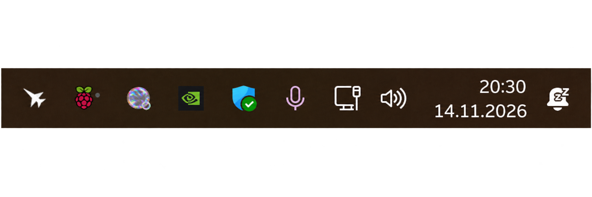
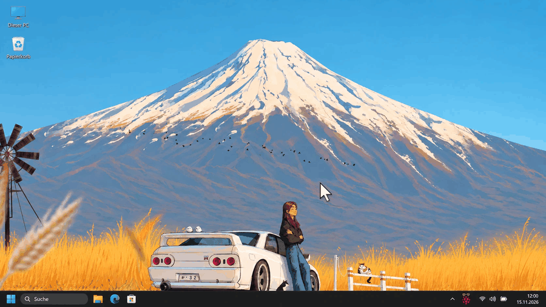
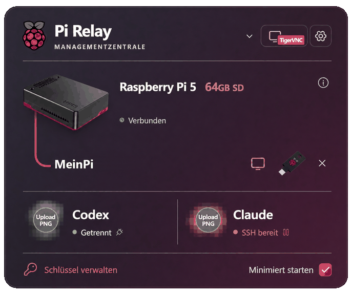

<a href="README.en.md"></a><a href="README.md"></a>

# Pi Relay

**Built for headless access to your Raspberry Pi: control it from your Windows desktop in a small viewer window, with no open VNC ports and updates built in.**

The manual fits on a beer mat: download, point it at your SSH key (a YubiKey is welcome, the Pi loves hardware), confirm once. From then on Pi Relay knocks through an SSH tunnel whenever needed and you work on the Pi as if it sat next to you. With a built-in FPS counter, in case you want to watch your Pi sweat.

<p align="center"></p>

<p align="center"></p>

<p align="center"></p>

<p align="center"></p>

*Heads-up: the app itself speaks German.*

<details>
<summary><b>💡 What it does</b></summary>

- **One line for everything.** Terminal, Pi screen and the AI helpers all share the same SSH connection. You sign in once, security keys (YubiKey & co.) included, and that's it. No confirming ten times.
- **The Pi desktop in its own window.** You see and use the Pi like a second screen, smooth and sharp. Everything runs through SSH: no VNC port open on your network, no account, no extra app. The window fits itself, you drag files in (they land on the Pi desktop), and copy & paste works between Windows and the Pi.
- **A real terminal** for everything you'd rather type.
- **Codex and Claude can work on the Pi**, but only where you let them: you give each AI one project folder. Reading is fine; changing files and running commands stay off until you switch them on one by one. The status tells you whether they're ready, connected or busy.
- **Your Windows mic on the Pi:** the "Mikro" switch in the screen window lets the Pi hear your Windows microphone over the same line. The Pi needs a small receiver program for that (`~/.local/bin/windows-mikro-empfang`).
- **Little extras:** see whether the Pi is reachable at all (no login), change the Pi's address right in the app, board facts (model, RAM, storage), your own pictures for the Pi, Codex and Claude (hold the mouse on one for a moment, then "PNG ändern") and an update check with one click on the version line in the tray menu.

</details>

<details>
<summary><b>🧰 Requirements</b></summary>

**On Windows:** Windows 10 or 11 (64-bit). WebView2 and the SSH client already come with current Windows versions.

**On the Pi:** SSH and Python 3 (both ship with Raspberry Pi OS) and your SSH accesses as entries in `~/.ssh/config`, e.g. `Host MeinPi` with `HostName 192.168.1.50`. Pi Relay only reads your public keys. It never touches private keys and never creates new ones.

**For the Pi screen** the Pi needs a program that shares its desktop (a VNC server). Important: it may listen **on the Pi itself only** (`127.0.0.1:5900`), not on your whole network. Pi Relay then fetches the picture safely through the SSH line. Which program you pick doesn't matter. Three proven options:

**TigerVNC** (our pick, around 45 instead of 5 frames per second on a Pi 5 compared to x11vnc). Package `tigervnc-scraping-server`, in your user's autostart:

```bash
X0tigervnc -display :0 -rfbport 5900 -localhost -SecurityTypes None -AlwaysShared -AcceptSetDesktopSize=0
```

**x11vnc** (X11 desktop, e.g. Cinnamon), also in the autostart:

```bash
x11vnc -localhost -rfbport 5900 -forever -shared -nopw -quiet -noxdamage
```

**WayVNC** (Wayland, e.g. labwc), in `/etc/wayvnc/config`:

```ini
use_relative_paths=true
address=127.0.0.1
enable_auth=false
```

**In short:** `-localhost` or `address=127.0.0.1` means "reachable on the Pi itself only". That's a must here, because no VNC password is set. In the screen window, quality 7 is the sweet spot (the green dot on the slider).

<details>
<summary>For the curious: password, firewall rule and what happens after a Pi restart</summary>

Nobody on the network can reach the VNC server, only Windows through your SSH connection. Programs or other users **on the Pi itself** could, though. If you're the only one using the Pi, that's fine. Otherwise set a VNC password (WayVNC `enable_auth=true`, x11vnc `-rfbauth`): Pi Relay asks for it in the window and keeps it only while the app runs. Also, Pi Relay only connects when port 5900 belongs to your own user or root, so a foreign program jumping the queue gets neither keyboard nor clipboard.

Instead of a password you can use a firewall rule (nftables) that opens the port for your desktop user only. Replace `1000` with that user's number (UID), load it with `sudo nft -f vnc-schutz.nft`, permanently via `/etc/nftables.conf`:

```
table inet vnc_schutz {
  chain ausgang {
    type filter hook output priority 0; policy accept;
    oifname "lo" tcp dport 5900 meta skuid != { 1000, 0 } reject with tcp reset
  }
}
```

If the Pi is restarting, Pi Relay waits patiently: click "Verbinden" and it connects exactly once as soon as the Pi answers again (up to 3 minutes). If the VNC server needs a little longer after boot, the viewer keeps trying for up to 2 minutes. It never asks for your security key on its own.

A second access named `Ersatzzugang` (e.g. with a spare key) is shown as a collapsible backup below the first one.

</details>

</details>

<details>
<summary><b>🛠️ Build it yourself</b></summary>

Just want to get going? Grab the ready-made installer under **Releases** on the right. Building is only for tinkerers.

You need the .NET 10 SDK, Node.js 22 or newer and, for the installer, Inno Setup 6. Then, in the project folder:

```bash
npm ci
powershell -ExecutionPolicy Bypass -File build-windows.ps1
powershell -ExecutionPolicy Bypass -File scripts/run-checks.ps1
powershell -ExecutionPolicy Bypass -File build-installer.ps1
```

That builds the app, runs all checks and packs the installer at the end.

</details>

<details>
<summary><b>🔒 Security in brief</b></summary>

- No network service on the Pi: the worker (`native/remote_worker.py`) only runs for the duration of the SSH session.
- The VNC tunnel knows exactly one fixed target (`127.0.0.1:5900`), never a freely chosen address.
- Agent file access is limited to the granted folder; `/` is refused as a project folder, the home folder (and any folder above it) is read-only, and even then its hidden folders stay closed. Hidden folders such as `~/.config` (autostart!) are writable only together with commands. Without the command permission, hidden files and folders (e.g. `.git/`, `.bashrc`) as well as executable and multiply linked files are refused. Keys, credentials and histories (`~/.ssh`, `~/.gnupg`, `~/.codex`, `~/.claude`, `.git-credentials`, shell histories, browser profiles) are never readable by agents. Write access is still powerful, e.g. for build scripts in the folder. Granted **shell commands** run with the Linux user's rights; for real separation use a dedicated restricted Pi user.
- The MCP server is a local named pipe for the current Windows user only; a pipe of the same name owned by another account is refused.
- The local port for an external viewer (RealVNC/TigerVNC) serves only the viewer Pi Relay started itself, and only under your own Windows account.
- Pi Relay's SSH connection takes no forwardings from the ssh config (agent, X11, ports, LocalCommand).
- "Zwischenablage teilen" (clipboard sharing) works in both directions only while the screen window is in front; a reconnect in the background transfers nothing. Windows text goes to the Pi when you switch into the window (up to 1 MiB), except content that password managers mark as confidential (that only goes via "An Pi"). Text from the Pi arrives without control and direction characters and without a trailing line break, so nothing runs by itself when pasted into a console. Both directions can be switched off in the settings.
- Restarting or activating while SSH connections are open asks first.
- The interface runs under a strict Content Security Policy; downloads and permissions (except the microphone in the screen window) are blocked. The installer installs inside the user profile only.
- Pi Relay takes noVNC updates no earlier than 14 days after release, without install scripts and with npm signature verification.
- Oversized or unexpected answers from the Pi only end that single request, not the connection or the app.

</details>

<details>
<summary><b>🖼️ Pictures and trademarks</b></summary>

The source code is under the [MIT license](LICENSE). The characters, the case picture and the icons are **not** covered by it. Raspberry Pi, Claude/Anthropic, Codex/OpenAI, RealVNC and other names are trademarks of their owners. Pi Relay is a private hobby project and not affiliated with any of these companies. Details and third-party software (noVNC, MPL-2.0): see [THIRD-PARTY-NOTICES.md](THIRD-PARTY-NOTICES.md).

</details>
