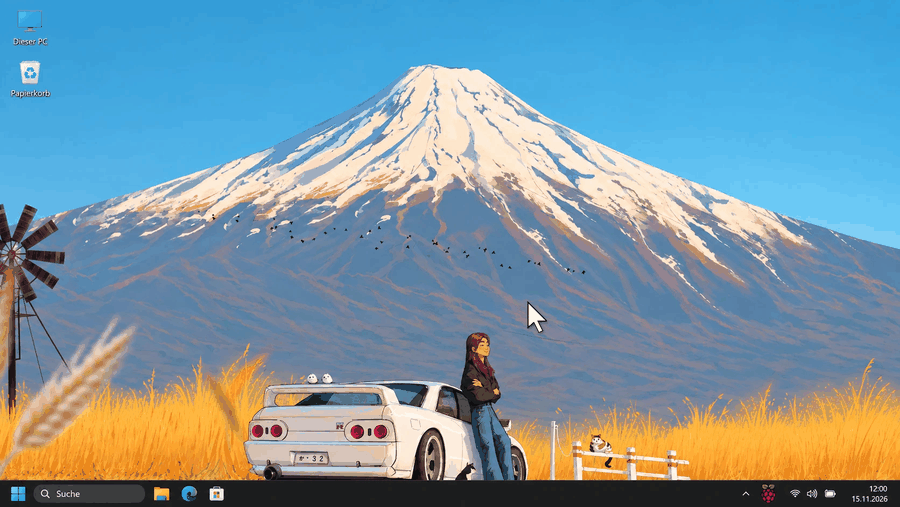
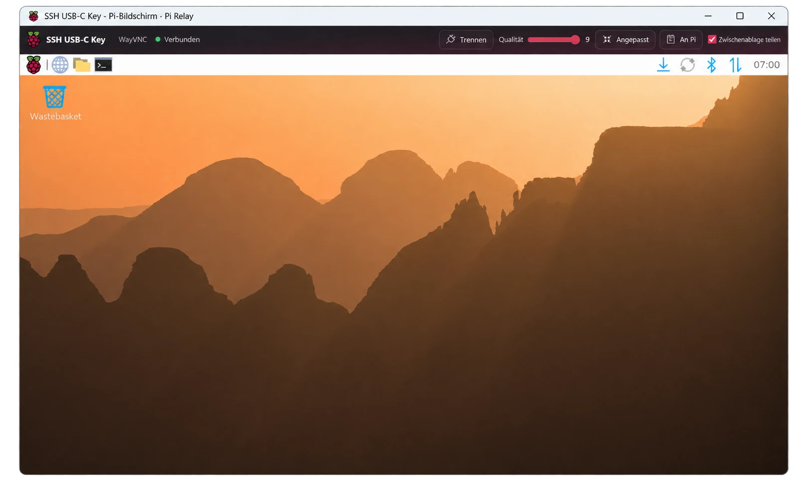
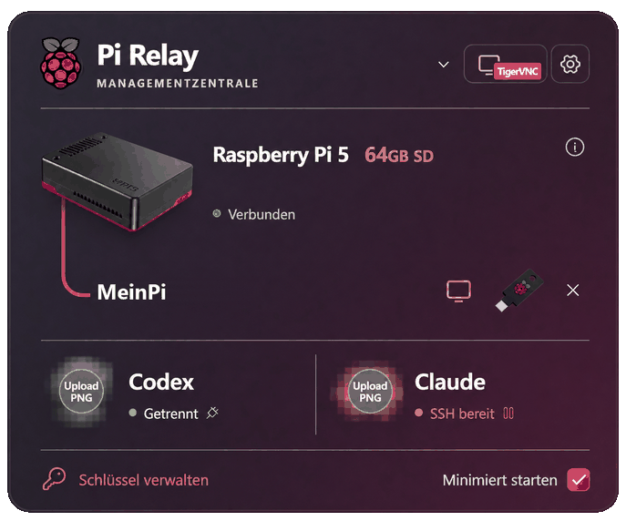

# Pi Relay

**Gebaut für den Headless-Zugriff auf deinen Raspberry Pi: Du steuerst ihn vom Windows-Desktop aus, in einem kleinen Viewer-Fenster, ohne offene VNC-Ports und mit eingebauten Updates.**

Die Anleitung passt auf einen Bierdeckel: herunterladen, SSH-Schlüssel angeben (gern auch deinen YubiKey, der Pi steht auf Hardware), einmal bestätigen. Ab dann klopft Pi Relay bei Bedarf per SSH-Tunnel an und du arbeitest auf dem Pi, als stünde er neben dir. Mit eingebauter FPS-Anzeige, falls du deinem Pi beim Schwitzen zusehen willst.

*Built for headless access to your Raspberry Pi: control it from your Windows desktop in a small viewer window, no open VNC ports, updates built in. Download, point it at your SSH key (a YubiKey works fine), confirm once, done. English below.*

<p align="center"></p>

<p align="center"></p>

<p align="center"></p>

<p align="center"></p>

## Was es kann

- **Ein SSH-Kanal pro Zugang.** Terminal, Bildschirm und Agenten teilen sich dieselbe OpenSSH-Verbindung. Hardware-Sicherheitsschlüssel (FIDO2/`sk-`) funktionieren, die Bestätigung erfolgt einmal.
- **Integrierter Pi-Bildschirm.** noVNC läuft lokal im eigenen Fenster und tunnelt RFB durch die bestehende SSH-Verbindung zu `127.0.0.1:5900` auf dem Pi. Es gibt keinen offenen VNC-Port, keinen lokalen Listener, kein Konto und keinen externen Viewer. Das Fenster passt sich weich dem Seitenverhältnis an, Dateien lassen sich per Drag & Drop direkt auf den Pi-Desktop ziehen, die Zwischenablage wird übertragen. RealVNC/TigerVNC bleiben als ausdrücklich gewählter Rückfall möglich.
- **Echtes Terminal** (xterm.js mit Linux-PTY) im eigenen Fenster.
- **Codex und Claude als Agenten auf dem Pi.** Pi Relay stellt einen lokalen MCP-Server (`PiRelay.exe --mcp codex|claude`) bereit. Pro Agent legst du einen Projektordner fest; Schreiben und Befehle sind standardmäßig aus und werden einzeln freigegeben. Die Statusanzeige unterscheidet „SSH bereit“, „Verbunden“ und „Arbeitet“.
- **Windows-Mikrofon im Pi:** Schalter „Mikro“ im Bildschirmfenster schickt dein Windows-Mikrofon (48 kHz, mono) über dieselbe SSH-Verbindung an ein Empfängerprogramm auf dem Pi (`~/.local/bin/windows-mikro-empfang`, z. B. eine PipeWire-Quelle). VNC selbst überträgt kein Audio.
- **Kleinigkeiten:** Ping-Erreichbarkeit (rein ICMP, ohne Anmeldung), Pi-Adresse direkt ändern (passt `~/.ssh/config` und `known_hosts` mit Sicherung an), Board-Infos (Modell, RAM, Speicher), eigene Bilder über „PNG ändern“ (kurz auf dem Bild verweilen), Update-Prüfung für den integrierten Viewer.

## Voraussetzungen

- Windows 10/11 x64 mit WebView2 Runtime und dem eingebauten OpenSSH-Client
- Raspberry Pi mit SSH und Python 3. Für den Bildschirm braucht der Pi einen VNC-Server, der **nur lokal auf `127.0.0.1:5900`** lauscht und keine eigene Anmeldung verlangt. Pi Relay fragt nicht nach einem bestimmten Programm. Beispiel **WayVNC** (Wayland, z. B. labwc):

```ini
# /etc/wayvnc/config
use_relative_paths=true
address=127.0.0.1
enable_auth=false
```

Beispiel **x11vnc** (X11-Desktop, z. B. Cinnamon), gestartet im Autostart des angemeldeten Benutzers:

```bash
x11vnc -localhost -rfbport 5900 -forever -shared -nopw -quiet -noxdamage
```

Beispiel **TigerVNC** (X11-Desktop, Paket `tigervnc-scraping-server`), ebenfalls im Autostart des angemeldeten Benutzers. Auf einem Pi 5 deutlich flüssiger als x11vnc (gemessen rund 45 statt 5 Bilder pro Sekunde):

```bash
X0tigervnc -display :0 -rfbport 5900 -localhost -SecurityTypes None -AlwaysShared -AcceptSetDesktopSize=0
```

`-localhost` lauscht nur auf 127.0.0.1 und ::1. `-SecurityTypes None` verzichtet auf ein VNC-Passwort, deshalb ist `-localhost` Pflicht. `-AlwaysShared` erlaubt mehrere Viewer gleichzeitig, `-AcceptSetDesktopSize=0` verhindert, dass ein Viewer die Auflösung verstellt. Der Wrapper `x0vncserver` startet dasselbe Programm. Im Bildschirmfenster ist Qualität 7 der beste Kompromiss (grüner Punkt am Regler); Stufe 9 erzeugt ein Vielfaches an Daten.

Auf `127.0.0.1` ist der Server **aus dem Netzwerk** nicht erreichbar, Windows kommt nur über die SSH-Verbindung heran. Programme und weitere Benutzer **auf dem Pi selbst** können `127.0.0.1:5900` aber erreichen. Ohne VNC-Passwort ist das nur auf einem Pi vertretbar, den du allein nutzt und auf dem keine fremden Dienste laufen. Sonst ein VNC-Passwort setzen (WayVNC `enable_auth=true`, x11vnc `-rfbauth`): Pi Relay fragt es im Bildschirmfenster ab und behält es nur im Arbeitsspeicher. Nie auf `0.0.0.0` bzw. ohne `-localhost` betreiben. Pi Relay verbindet nur, wenn Port 5900 dem eigenen Benutzer oder root gehört, geprüft vor und nach dem Verbinden; ein fremder Prozess, der den Port vorher belegt, bekommt so weder Tastatur noch Zwischenablage.

Statt eines VNC-Passworts lässt sich der Port auch auf den Desktop-Benutzer beschränken, zum Beispiel mit nftables. `1000` durch dessen UID ersetzen; der Worker von Pi Relay läuft als dieser Benutzer und bleibt erlaubt. Laden mit `sudo nft -f vnc-schutz.nft`, dauerhaft über `/etc/nftables.conf`:

```
table inet vnc_schutz {
  chain ausgang {
    type filter hook output priority 0; policy accept;
    oifname "lo" tcp dport 5900 meta skuid != { 1000, 0 } reject with tcp reset
  }
}
```

Nach einem Neustart des Pi wartet Pi Relay geduldig: Ein Klick auf „Verbinden“, solange der Pi noch nicht antwortet, verbindet genau einmal, sobald er wieder da ist (bis zu 3 Minuten). Startet der VNC-Server erst nach der Desktop-Anmeldung, versucht der Viewer es bis zu 2 Minuten lang über die bestehende SSH-Verbindung weiter. Neue Abfragen des Sicherheitsschlüssels ohne deinen Klick gibt es nicht.

- Ein zweiter Zugang namens `Ersatzzugang` (z. B. mit einem Ersatz-Sicherheitsschlüssel) wird als einklappbarer Ersatzzugang unter dem ersten angezeigt; alle anderen Aliase erscheinen normal untereinander.
- SSH-Zugänge als Aliase in `~/.ssh/config` (z. B. `Host MeinPi` mit `HostName 192.168.1.50`). Pi Relay liest nur öffentliche Schlüssel, kopiert keine privaten Schlüssel und erzeugt keine neuen.

## Bauen

Benötigt das .NET 10 SDK, Node.js 22+ und für den Installer Inno Setup 6.

```bash
npm ci
powershell -ExecutionPolicy Bypass -File build-windows.ps1
powershell -ExecutionPolicy Bypass -File scripts/run-checks.ps1
powershell -ExecutionPolicy Bypass -File build-installer.ps1
```

## Sicherheit in Kürze

- Kein Netzwerkdienst auf dem Pi: Der Worker (`native/remote_worker.py`) läuft nur für die Dauer der SSH-Sitzung.
- Der VNC-Tunnel kennt genau ein festes Ziel (`127.0.0.1:5900`), keine frei wählbare Adresse.
- Agenten-Dateizugriffe sind auf den freigegebenen Ordner begrenzt; `/` ist als Projektordner gesperrt, der Home-Ordner (und jeder Ordner darüber) nur zum Lesen, und auch dann bleiben die versteckten Ordner darin zu. Versteckte Ordner wie `~/.config` (Autostart!) gibt es mit Schreibrecht nur zusammen mit Befehlen. Ohne Befehlsrecht sind versteckte Dateien und Ordner (z. B. `.git/`, `.bashrc`) sowie ausführbare und mehrfach verlinkte Dateien gesperrt. Schlüssel, Zugangsdaten und Verläufe (`~/.ssh`, `~/.gnupg`, `~/.codex`, `~/.claude`, `.git-credentials`, Shell-Verläufe, Browser-Profile) sind für Agenten nie lesbar. Schreibrechte bleiben trotzdem mächtig, etwa für Build-Skripte im Ordner. Freigegebene **Shell-Befehle** haben die Rechte des Linux-Benutzers; für echte Trennung einen eigenen eingeschränkten Pi-Benutzer verwenden.
- Der MCP-Server ist eine lokale Named Pipe nur für den aktuellen Windows-Benutzer; eine gleichnamige Pipe eines anderen Kontos wird abgelehnt.
- Der lokale Port für einen externen Viewer (RealVNC/TigerVNC) bedient nur den Viewer, den Pi Relay selbst gestartet hat, und nur unter dem eigenen Windows-Konto.
- Die SSH-Verbindung von Pi Relay übernimmt keine Weiterleitungen aus der ssh-config (Agent, X11, Ports, LocalCommand).
- „Zwischenablage teilen“ wirkt in beide Richtungen nur, solange das Bildschirmfenster vorne ist; ein Neuverbinden im Hintergrund überträgt nichts. Windows-Text geht beim Wechsel ins Fenster an den Pi (bis 1 MiB), außer Inhalten, die Passwortmanager als vertraulich markieren (die nur über „An Pi“). Text vom Pi kommt ohne Steuer- und Richtungszeichen und ohne abschließenden Zeilenumbruch an, damit nichts beim Einfügen in eine Konsole von selbst ausgeführt wird. Beide Richtungen lassen sich in den Einstellungen abschalten.
- Ein Neustart oder eine Aktivierung bei offenen SSH-Verbindungen fragt vorher nach.
- Die Oberfläche läuft mit strikter Content-Security-Policy, Downloads und Berechtigungen (außer dem Mikrofon im Bildschirmfenster) sind gesperrt. Der Installer installiert nur innerhalb des Benutzerprofils.
- noVNC-Updates übernimmt Pi Relay frühestens 14 Tage nach Veröffentlichung, ohne Installationsskripte und mit npm-Signaturprüfung.
- Übergroße oder unerwartete Antworten des Pi beenden nur die einzelne Anfrage, nicht die Verbindung oder die App.

## Hinweis zu Bildern und Marken

Der Quellcode steht unter der [MIT-Lizenz](LICENSE). Die Figuren, das Gehäusebild und die Icons gehören **nicht** dazu. Raspberry Pi, Claude/Anthropic, Codex/OpenAI, RealVNC und weitere Namen sind Marken ihrer Inhaber. Pi Relay ist ein privates Hobbyprojekt und mit keinem dieser Unternehmen verbunden. Details und Fremdsoftware (noVNC, MPL-2.0) siehe [THIRD-PARTY-NOTICES.md](THIRD-PARTY-NOTICES.md).

---

## English

**Built for headless access to your Raspberry Pi from the Windows desktop.** Close the window any time: Pi Relay waits in the taskbar, one click on the berry brings the panel back.

Under the hood, Pi Relay is a Windows tray app that keeps **one OpenSSH connection per access alias** to a Raspberry Pi and shares it between:

- an **integrated VNC viewer** (noVNC, bundled locally) that tunnels RFB through that SSH connection to the Pi's VNC server (WayVNC, x11vnc or TigerVNC) on `127.0.0.1:5900`. No open VNC port, no account, no external viewer needed. Smooth aspect-ratio fit, drag-and-drop file upload to the Pi desktop, clipboard sync. RealVNC/TigerVNC remain an optional, explicit fallback.
- a real **terminal** (xterm.js + Linux PTY),
- **Codex and Claude** as agents on the Pi via a local MCP server (`PiRelay.exe --mcp codex|claude`), scoped to a project folder, with write and command access off by default.

Hardware security keys (FIDO2 `sk-` keys) work; you confirm once per connection. Requirements, VNC server examples (WayVNC, x11vnc, TigerVNC), an optional nftables rule and build steps are listed in the German section above (commands are the same). The UI is in German.

**License:** source code under [MIT](LICENSE). The pictures and icons are not covered by it; all trademarks belong to their owners and Pi Relay is not affiliated with Raspberry Pi Ltd, Anthropic, OpenAI or RealVNC. Third-party components: see [THIRD-PARTY-NOTICES.md](THIRD-PARTY-NOTICES.md).
